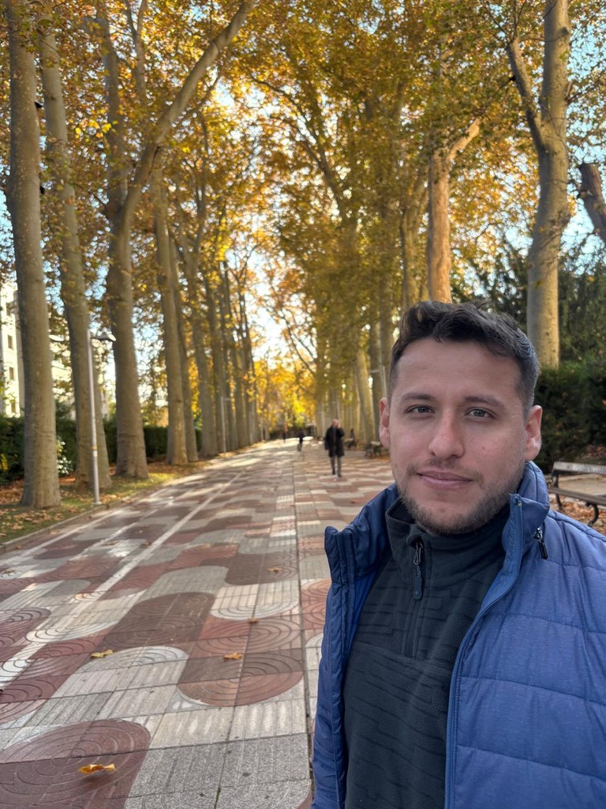

# 👨‍💻 Giovanny Orjuela — DevOps & SRE Engineer Portfolio

<div align="center">



<br/><br/>

**🌐 [Ver Portfolio en Vivo](https://poswark.github.io/personal-page/)**  

[](https://linkedin.com/in/giovannyorjuel2)
[](https://github.com/poswark)
[](https://github.com/Poswark/personal-page/actions/workflows/static.yml)

</div>

---

## 🚀 Sobre este proyecto

Portfolio personal de **Giovanny Orjuela**, Ingeniero DevOps & SRE con 8+ años de experiencia en infraestructura crítica, automatización y cloud. Construido como sitio estático con HTML, CSS y JavaScript puro — sin frameworks, sin dependencias de build.

Incluye:
- ⚡ Diseño glassmorphism con animaciones CSS y tema Dark Neon
- 🖥️ Terminal interactivo simulado en el hero
- 🌐 Selector bilingüe Español (ES) / Inglés (EN) en tiempo real
- 📄 Descarga de HV / Resume adaptada según el idioma activo (`cv.pdf` / `cv-en.pdf`)
- 📱 Responsive design para mobile, tablet y desktop
- 🐳 Contenedor Docker optimizado con Nginx no-root y docker-compose
- 🚀 Deploy automático a GitHub Pages vía GitHub Actions (jobs de `build` y `deploy`)

---

## 🗂️ Estructura del proyecto

```
personal-page/
├── index.html          # Estructura principal del sitio con atributos i18n
├── styles.css          # Estilos, variables CSS, glassmorphism y responsive
├── script.js           # Lógica: navegación, traducciones ES/EN y descarga de CV
├── images/
│   └── profile.jpeg    # Foto de perfil
├── cv.pdf              # Hoja de vida en español
├── cv-en.pdf           # Resume en inglés (B1 - Intermediate)
├── Dockerfile          # Imagen Docker ligera con Nginx unprivileged
├── docker-compose.yml  # Orquestación local para pruebas
├── .github/
│   └── workflows/
│       └── static.yml  # Pipeline de GitHub Actions (build & deploy a Pages)
└── README.md
```

---

## 🛠️ Stack técnico

| Área | Tecnología |
|------|-----------|
| Frontend | HTML5, CSS3, Vanilla JS |
| Iconos | [Font Awesome 6](https://fontawesome.com) |
| Hosting | GitHub Pages |
| CI/CD | GitHub Actions |
| Contenedores | Docker, Docker Compose, Nginx Unprivileged |

---

## ⚙️ Deploy

El sitio se despliega automáticamente a **GitHub Pages** al hacer push a la rama `trunk` o ramas `feature/*` / `feat/*`.

```yaml
# .github/workflows/static.yml
on:
  push:
    branches: ["trunk", "feature/*", "feat/*"]
  workflow_dispatch:
```

Para hacer deploy manualmente, ve a **Actions → Deploy Portfolio to GitHub Pages → Run workflow**.

---

## 🖥️ Correr localmente

No requiere instalación previa. Puedes correrlo con Docker, Python o Node.js:

```bash
# Con Docker Compose (recomendado)
docker compose up -d

# Con Python
python3 -m http.server 8080

# Con Node.js (npx)
npx serve .
```

Luego abre `http://localhost:8080` en tu navegador.

---

## 📄 Descarga de CV bilingüe

El botón **"Descargar HV"** / **"Download CV"** detecta el idioma seleccionado:
- **Español (ES)**: Descarga directa de `cv.pdf` como `Giovanny_Orjuela_DevOps_SRE_CV_ES.pdf`.
- **Inglés (EN)**: Descarga directa de `cv-en.pdf` como `Giovanny_Orjuela_DevOps_SRE_Resume_EN.pdf`.

---

## 📬 Contacto

| Canal | Info |
|-------|------|
| 💼 LinkedIn | [linkedin.com/in/giovannyorjuel2](https://linkedin.com/in/giovannyorjuel2) |
| 📧 Email | [giovannyorjuel2@gmail.com](mailto:giovannyorjuel2@gmail.com) |
| 📍 Ubicación | Bogotá, Colombia |

---

<div align="center">

© 2026 Giovanny Orjuela · Hecho con ❤️ en Bogotá

</div>
